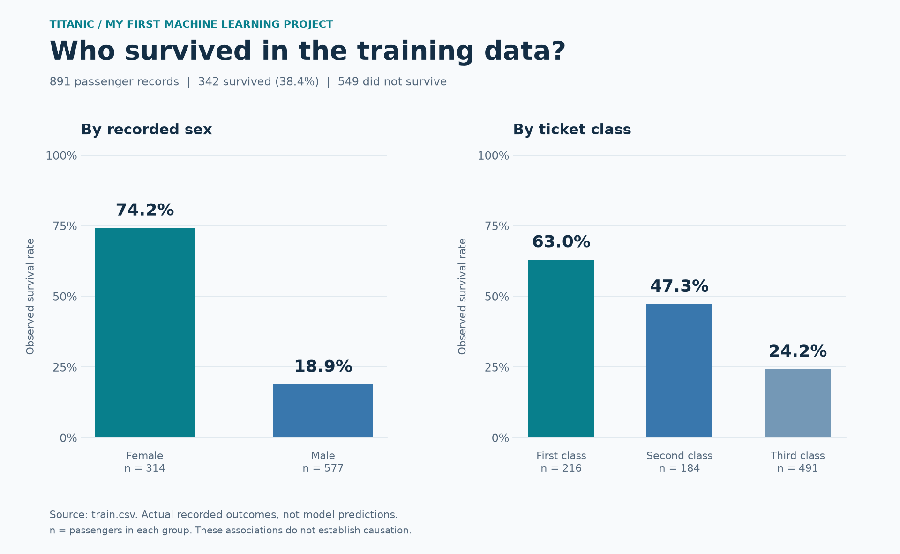
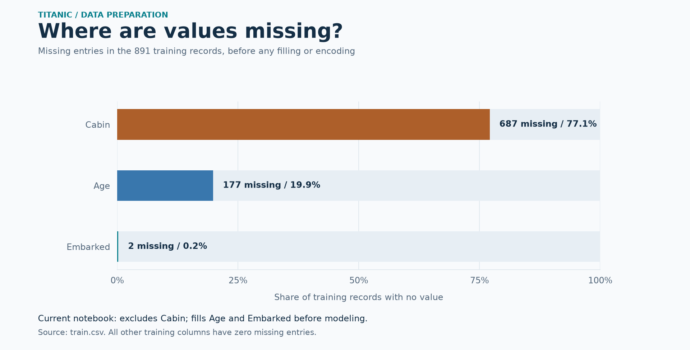
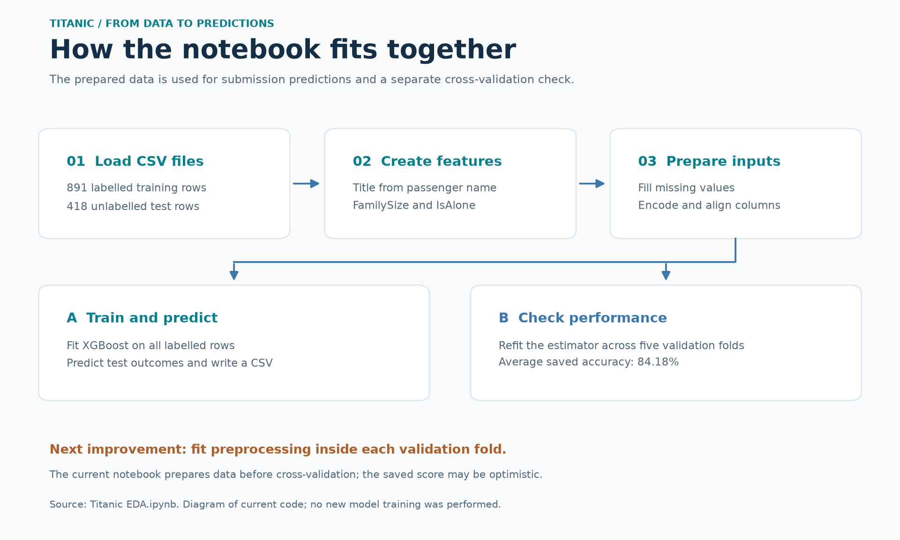

# Titanic Survival Prediction

### My first machine learning project

I used the Titanic passenger dataset to learn how to prepare data, create useful features, train a classification model, and evaluate its predictions. This repository documents my first machine learning project and the improvements I want to make as I learn.

**The question:** Can passenger details help predict who survived the Titanic disaster?

The notebook uses **Python, Pandas, scikit-learn, and XGBoost**. It learns from 891 labelled passenger records and produces survival predictions for 418 test passengers.



## Start here: dataset, model, and prediction

| Term | What it means in this project |
| --- | --- |
| **Dataset** | A table of passenger records. Each row represents a passenger; columns contain information such as age, fare, and ticket class. |
| **Feature** | A piece of information given to the model, such as a passenger's age or family size. |
| **Target** | The answer the model learns to predict: `Survived`, where `0` means did not survive and `1` means survived. |
| **Model** | The XGBoost classifier trained to find patterns between the features and the target. |
| **Training** | Learning those patterns from passengers whose survival outcome is known. |
| **Prediction** | The model's estimated class, `0` or `1`, for a passenger. |
| **Evaluation** | Checking predictions against known answers on validation data. |

**Titanic is the dataset; XGBoost is the model.** I am using an existing public dataset and an existing machine learning algorithm to build my first prediction project.

## Dataset

Source: [Kaggle Titanic competition](https://www.kaggle.com/competitions/titanic).

| File | Rows | Purpose |
| --- | ---: | --- |
| [`train.csv`](train.csv) | 891 | Passenger details and known survival outcomes. Used for training and cross-validation. |
| [`test.csv`](test.csv) | 418 | Passenger details without survival labels. Used to generate submission predictions. |
| [`updated submission.csv`](updated%20submission.csv) | 418 | Saved predictions, with `PassengerId` and `Survived` columns. |

The training data has 12 columns, including the target:

| Column | Meaning |
| --- | --- |
| `PassengerId` | Passenger identifier. |
| `Survived` | Target: `0` = did not survive, `1` = survived. |
| `Pclass` | Ticket class: first, second, or third. |
| `Name` | Passenger name; used to extract a title such as Mr, Mrs, or Miss. |
| `Sex` | Recorded sex. |
| `Age` | Age in years; some values are missing. |
| `SibSp` | Number of siblings or spouses aboard. |
| `Parch` | Number of parents or children aboard. |
| `Ticket` | Ticket identifier. |
| `Fare` | Ticket fare. |
| `Cabin` | Cabin identifier; many values are missing. |
| `Embarked` | Embarkation port: C = Cherbourg, Q = Queenstown, S = Southampton. |

## What the pictures show

The first chart uses the actual outcomes in `train.csv`, not model predictions:

- **342 of 891 passengers survived**, an observed survival rate of **38.4%**.
- Recorded female passengers had a **74.2%** survival rate; recorded male passengers had **18.9%**.
- Survival rates were **63.0% in first class**, **47.3% in second class**, and **24.2% in third class**.

These patterns describe this dataset. They do not, by themselves, establish why an individual passenger survived.



Missing values are part of the data-cleaning task. In the training file, `Cabin` is missing for 687 passengers, `Age` for 177, and `Embarked` for 2. The current model excludes `Cabin` and fills missing age and embarkation values before training.

## How the notebook works

Open [`Titanic EDA.ipynb`](Titanic%20EDA.ipynb) to follow the implementation.



### 1. Load the files

Pandas reads `train.csv` and `test.csv` into data tables called DataFrames.

### 2. Create useful features

The notebook adds three features:

- **`Title`:** Extracts a title from each name. Uncommon titles are grouped as `Rare`, and equivalent titles are combined.
- **`FamilySize`:** Calculates `SibSp + Parch + 1`. The extra `1` includes the passenger.
- **`IsAlone`:** Marks a passenger as `1` when `FamilySize` is one, otherwise `0`.

For example, someone travelling with one sibling and two parents has a family size of `1 + 2 + 1 = 4`, so `IsAlone = 0`.

### 3. Prepare the model inputs

- Fill missing ages using the median for passengers with the same sex and ticket class.
- Fill missing fares with the median and missing embarkation ports with the most common value.
- Convert `Sex`, `Embarked`, and `Title` into numerical indicator columns using one-hot encoding.
- Align the training and test columns so the model receives the same feature structure.
- Exclude `Survived`, `Name`, `Ticket`, `Cabin`, and `PassengerId` from the input features. Keep `Survived` separately as the target.

The current code calculates fill values separately for the training and test files. Reusing values learned from training data is an improvement planned below.

### 4. Train XGBoost and generate predictions

XGBoost combines many decision trees. Each new tree helps improve the combined prediction. In this project, it predicts one of two survival classes, making this a **binary classification** problem.

The notebook uses these settings:

| Setting | Value | Simple explanation |
| --- | ---: | --- |
| `n_estimators` | 500 | Number of boosting rounds. |
| `max_depth` | 4 | Maximum depth of each tree. |
| `learning_rate` | 0.03 | Controls how much each new tree contributes. |
| `subsample` | 0.8 | Uses a sample of the training rows per boosting round. |
| `colsample_bytree` | 0.8 | Uses a sample of the feature columns per tree. |
| `random_state` | 42 | Controls randomness to help reproduce the experiment. |

`RandomForestClassifier` is imported in the notebook but is not trained. The recorded model and score are for **XGBoost**.

### 5. Evaluate with five-fold cross-validation

Cross-validation divides the labelled data into five groups. For each round, the estimator is trained on four groups and evaluated on the remaining group. Each group becomes the validation set once, and the five accuracy scores are averaged.

**Accuracy** is the fraction of passengers whose survival class was predicted correctly.

| Recorded result | Value |
| --- | --- |
| Model | XGBoost classifier |
| Evaluation | Five-fold cross-validation |
| Mean accuracy saved in the notebook | **84.18%** |
| Exact saved output | `0.8417550687339151` |

This is an existing notebook result, not a new training run or a verified Kaggle leaderboard score. No test-set accuracy can be calculated from the included `test.csv`, because its true survival labels are absent.

**Evaluation limitation:** the current notebook performs preprocessing before cross-validation. This allows validation-fold information to influence preprocessing statistics and can make the score optimistic. A better evaluation would fit preprocessing inside each fold using a pipeline. See [scikit-learn's explanation of data leakage](https://scikit-learn.org/stable/common_pitfalls.html#data-leakage).

### 6. Save the submission

The notebook exports the predicted survival class for every test passenger. A submission has this structure:

```text
PassengerId,Survived
<passenger ID>,<0 or 1>
```

**Filename note:** the notebook's final cell currently writes `" updated submission.csv"`, including a leading space. The file committed to this repository is named `updated submission.csv` without that space. To produce the same clean filename locally, use:

```python
output.to_csv("updated submission.csv", index=False)
```

## Run the project locally

You need Python 3 and Git. Run these commands in a terminal:

```bash
git clone https://github.com/Vishal123-tech/Titanic.git
cd Titanic
python -m venv .venv
```

Activate the environment using the command for your terminal:

| Terminal | Command |
| --- | --- |
| Windows PowerShell | `.venv\Scripts\Activate.ps1` |
| Windows Command Prompt | `.venv\Scripts\activate.bat` |
| macOS or Linux | `source .venv/bin/activate` |

Install the dependencies and open the notebook:

```bash
python -m pip install pandas scikit-learn xgboost notebook
python -m notebook "Titanic EDA.ipynb"
```

Select the environment's Python kernel and run the cells from top to bottom. Keep `train.csv` and `test.csv` in the same folder as the notebook. The original notebook also runs `pip install xgboost` in its first cell.

Dependency versions are not pinned in this repository, so results may differ across package versions.

## Repository guide

```text
Titanic/
|-- README.md
|-- Titanic EDA.ipynb
|-- train.csv
|-- test.csv
|-- updated submission.csv
|-- LICENSE
|-- docs/
|   |-- generate_figures.py
|   `-- images/
|       |-- survival-patterns.png
|       |-- missing-values.png
|       `-- model-workflow.png
`-- 06. Airline Passenger Satisfaction/
```

The [Airline Passenger Satisfaction folder](06.%20Airline%20Passenger%20Satisfaction/README.md) is a separate project stored in this repository. Its models and results are not part of the Titanic experiment.

### Recreate the pictures

The charts are generated from the repository's `train.csv`; they are not screenshots of notebook outputs. The workflow picture explains the current notebook. From the repository root, run:

```bash
python -m pip install matplotlib
python docs/generate_figures.py
```

## My learning goals and next steps

This first project gives me practice with missing values, feature engineering, categorical encoding, classification, cross-validation, and creating a submission file.

Next, I want to:

- Fit preprocessing inside each cross-validation fold, and apply training-fitted transformations to test data.
- Add exploratory charts and written observations to the notebook itself.
- Compare XGBoost against simple baselines, Logistic Regression, and Random Forest using the same validation approach.
- Add a confusion matrix, precision, recall, and F1 score to understand prediction errors.
- Record dependency versions and save a complete preprocessing-and-model pipeline.

These are planned improvements, not features already implemented in the Titanic notebook.

## Author and credits

**Vishal Yadav** — [GitHub profile](https://github.com/Vishal123-tech)

Dataset: [Kaggle Titanic competition](https://www.kaggle.com/competitions/titanic). See the repository's [license](LICENSE) for the code; dataset use is subject to its source terms.
